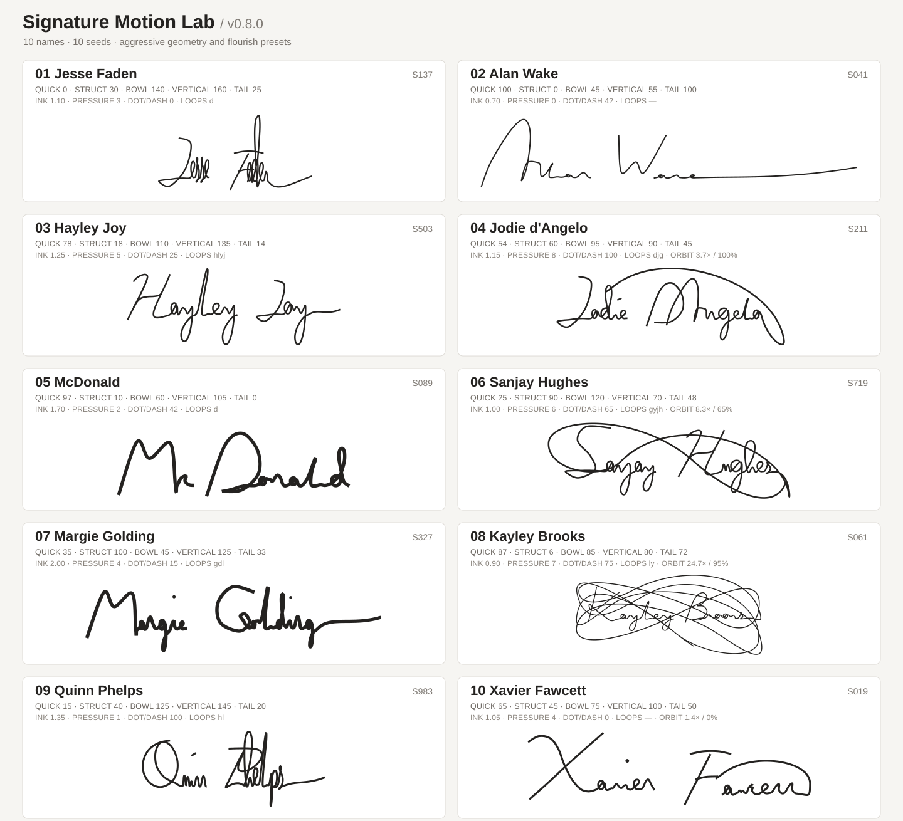

# Signature Motion Lab

**离线运行的程序化草签生成测试项目** · Offline procedural signature rendering experiment



上图为 v0.8.0 实际生成的十组样例，覆盖横向压缩、纵向拉伸、大小圈体、笔宽、结构保留、点划、大回环与非周期性尾迹。首组为 Jesse Faden，快写 0%、纵向 160%、圈体 140%。[完整参数与随机种子（JSON）](assets/sample-grid-v080.json)。

本项目用于虚构文稿、档案与创作型界面中的 **装饰性签名视觉渲染**。输入英文姓名后，生成包含大写起笔、压缩的短划、小回环、可选 `g / d / l / y / j / h` 大回环和连续尾迹的矢量笔迹。

> **项目状态：v0.8.0 实验原型。** 轨迹基于手工几何运动文法，并未从真人签名数据中学习。生成结果不应被用于身份认证、模仿真实人员签名或代替具有法律效力的电子签署。

## 快速开始

下载或克隆仓库，双击打开 [`index.html`](index.html) 即可使用，无需 Node.js、后端服务、API Key、字体下载或网络连接。

```bash
git clone https://github.com/HSqure/signature-motion-lab.git
cd signature-motion-lab
# 用浏览器打开 index.html
```

## 功能

- **姓名驱动**：英文姓名按大写字母划分运动段；如 `McDonald` 中的 `M` 和 `D` 均为起笔锚点。
- **短划风格**：小写字符以压缩运动原语表达，保留局部自然小回环；支持 `g / d / l / y / j / h` 的可选大回环。
- **点划保留**：`i / j` 的上方标记可选择点或极短斜划。
- **连续尾迹**：尾迹与最后一个书写段共用同一条中心线路径，尾迹与主体接点满足位置连续（C⁰）。
- **形态调节**：快写程度（联动运动速度、缩写与横向拉伸）、圈体大小、纵向拉伸、结构保留、线宽与微弱笔压；整体流畅度、圆滑度和小回环强度固定为 100%。
- **非周期尾迹**：可选不规则连续回绕模式，控制长度倍率与噪声；参考横八字走势但不限制整圈数。
- **确定性输出**：姓名、参数、随机种子一致时输出一致；重新签署生成微小变化。
- **SVG 导出**：导出可缩放矢量图形（Scalable Vector Graphics，SVG）。

## 技术说明

实现：**原生 HTML / JavaScript / SVG，零运行时依赖**。

核心流程：

```text
姓名文本 → 按大写字母分段
        → 大写锚点 + 小写压缩笔势 + 回环 / 点划
        → 每段连续轨迹 + 最后一段连续尾迹
        → 低频相关扰动
        → 曲线插值与近平恒线宽轮廓
        → SVG
```

**早期 v0.5 的设计与数学细节（历史技术报告）：** [《从字体拼接到连续笔势》技术报告](docs/technical-report.zh-CN.md)。

当前限制：算法尚未接受真人笔迹数据分布评估，中文姓名生成支持不完善，切线连续性仅近似处理；它适合视觉实验，不适合取证或签名验证。

## 仓库结构

```text
signature-motion-lab/
├── index.html                   # 离线实验台，含生成算法和交互界面
├── docs/
│   └── technical-report.zh-CN.md
├── assets/
│   ├── preview.png             # v0.5 历史预览
│   ├── sample-grid-v080.svg     # v0.8.0 十组签名图册
│   └── sample-grid-v080.json    # 可复现的完整参数
├── tests/
│   ├── test_signature.py        # Playwright 回归测试
│   └── baseline-results.json    # v0.5 已验证的样本结果
├── LICENSE
├── .gitignore
└── README.md
```

## 运行测试

```bash
python -m pip install playwright
python -m playwright install chromium
python tests/test_signature.py
```

测试核查：十组图册参数的确定性输出、轨迹坐标有限性、尾迹连续性、极端形态参数、浏览器交互及 SVG 导出。`tests/baseline-results.json` 是项目开发阶段的测试快照，不代表跨机器的性能基准。

## 许可证 / License

本项目使用 [MIT License](LICENSE)。允许个人与商业使用、修改、分发和再授权；复制或实质性使用软件时应保留原版权声明与许可证文本。

Copyright © 2026 Hua Hua.
