# 从姓名到笔迹：Signature Motion Lab 的程序化草签生成算法

2026 年 11 月 17 日 · Signature Motion Lab v0.8.0

[项目源码](https://github.com/HSqure/signature-motion-lab/tree/2a83da6582569ef2168d9d7c585609d8b40c6c2a) · [完整样例参数](https://github.com/HSqure/signature-motion-lab/blob/main/assets/sample-grid-v080.json) · [浏览器回归测试](https://github.com/HSqure/signature-motion-lab/blob/main/tests/test_signature.py)

签名是一种高度压缩的书写动作。首字母、上行折返、下探笔画和点划提供有限的辨识信息；大部分中间字母则被简化为沿基线连续运动的短划。对于游戏档案、企业内部文稿和虚构角色的视觉资产生成，这种信息分布比完整的手写字形更有价值：我们希望从任意英文姓名生成风格连贯、可以调节、具有个体差异的草签，并能将其作为矢量资产嵌入文稿。

Signature Motion Lab 将这个问题分解为**有序笔势生成、曲线几何处理和墨迹渲染**三个层次。笔势由手工设计的运动原语（Motion Primitive）构成；局部尺度、结构保留和随机流控制书写形态；最终使用曲线插值、弧长重采样及法向轮廓展开生成可缩放矢量图形（Scalable Vector Graphics，SVG）。整个实现位于一个 HTML（HyperText Markup Language，超文本标记语言）文件内，使用原生 JavaScript，无运行时依赖。

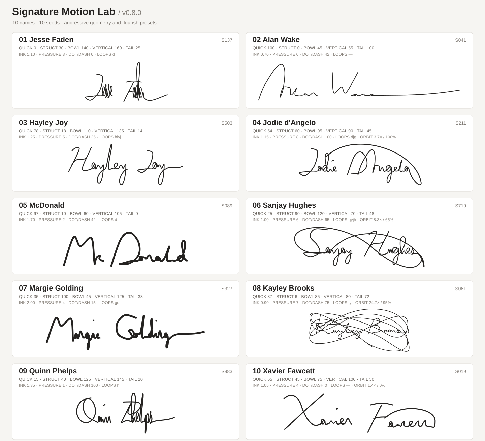

*图 1. v0.8.0 生成样例。各组使用独立种子及不同的形态、笔宽和尾笔设置。完整配置保存在仓库的样例参数文件中。*

## 1. 问题定义与建模方法

从姓名生成草签，可以视为一个条件几何生成问题。输入姓名 $n$、风格参数集合 $\Theta$ 和本次书写的随机种子 $k$，产生一组有序笔画 $\mathcal S$：

$$
\mathcal S=G(n,\Theta,k),\qquad I=R(\mathcal S,\Theta).
$$

$G$ 负责生成中心线及提笔后的点划，$R$ 负责生成墨迹图形 $I$。二者共享部分参数，但轨迹和介质在表示上相互独立。同一个几何结构可以使用不同线宽渲染；反过来，改变字母的纵横比例无需重新设计笔尖的宽度函数。

对这类生成器，姓名的信息需要在三个空间尺度上组织：

| 尺度 | 对应特征 | 几何任务 |
| --- | --- | --- |
| 全局 | 姓名分段、基线、尾笔 | 确定整体节奏、宽高比及视觉重心 |
| 字母级 | 大写锚点、上行杆、下探杆、主体圈 | 保留具有区分度的笔势拓扑 |
| 笔画级 | 曲率、细微漂移、线宽 | 保持流线连续，形成圆珠笔墨迹的尺度特征 |

这种分解允许字母的辨识度不均匀地分布在姓名上。例如 `Jesse Faden` 的两个大写起笔分别建立局部视觉锚点；中间的 `esse` 和 `aden` 主要承担连贯书写节奏；最后一个小写的终点确定尾笔的出发位置。

当前实现采用空间几何模型。运动速度是作用于字母尺度的代理参数，笔压是作用于轮廓宽度的代理参数。未来可以用显式时间参数 $t$ 扩展为在线手写轨迹 $S(t)=(x(t),y(t),p(t),q(t))$，其中 $p$ 为压力，$q$ 为笔尖接触状态。这一扩展可复用本文后半部分的曲线处理和渲染层。

## 2. 生成管线与数据表示

生成过程分为条件解析、笔势构造和几何渲染三个阶段。正文以下各节按数据流顺序展开。

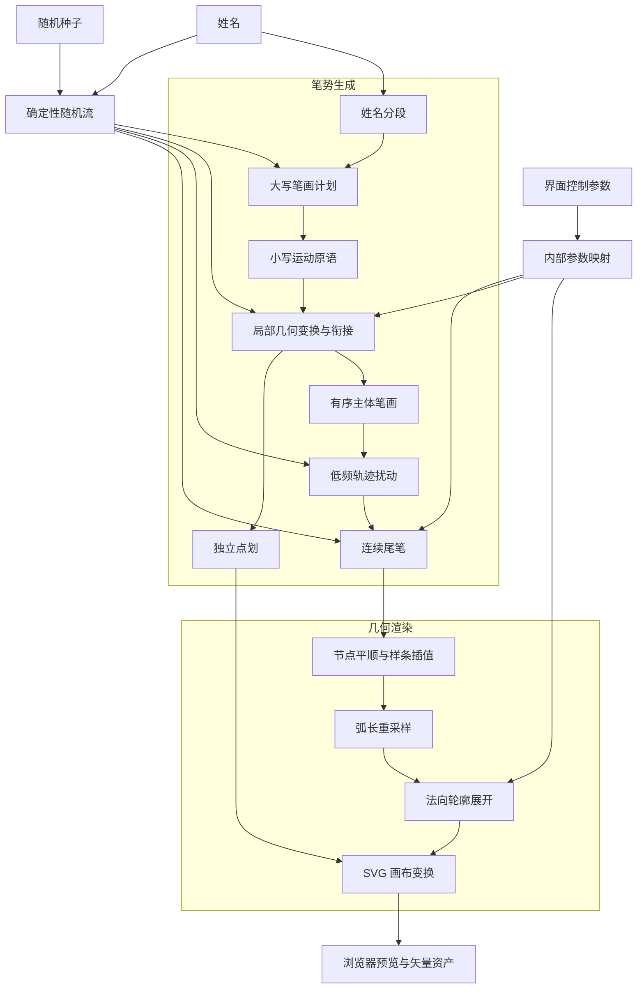

*图 2. 生成管线。`generate()` 输出笔画及事件数据，`render()` 在此基础上构造完整 SVG。*

签名的基本几何对象是有序点列 $P=(P_0,P_1,\ldots,P_m)$。点列的顺序表示笔尖经过各位置的先后关系，多个笔画之间允许提笔。相邻点之间形成的连续墨迹由后续曲线处理阶段确定。

对应的 JavaScript 数据可以用以下 TypeScript 类型概括（源码为普通 JavaScript）：

```typescript
type Point = { x: number; y: number };

type Stroke = {
  type: 'stroke';
  tag: 'capital-part' | 'capital-main' | 'segment';
  points: Point[];
  seed: number;          // 当前轮廓的调制相位
  orbitLength?: number;  // 盘绕实际消耗的长度
  orbitTarget?: number;  // 盘绕目标长度
};

type Mark =
  | { type: 'dot'; x: number; y: number; r: number }
  | { type: 'dash'; x: number; y: number; dx: number; dy: number };
```

`generate()` 返回 `strokes` 数组、分段数量、回环事件、点划数量、主体末端 `terminal` 及尾笔起点 `tailJoin`。点划与主体路径先分开构造，最后合并至输出数组。`render()` 在返回这些数据的同时附加 SVG 字符串，便于对同一次生成同时进行几何分析和实际显示。

## 3. 姓名分段与整体布局

### 3.1 以大写字母作为结构锚点

英文姓名中的大写字符天然适合承担一段笔势的起始动作。分段器 `parseSegments()` 识别 ASCII（American Standard Code for Information Interchange，美国信息交换标准代码）拉丁字母：每次遇到大写字母、空格或标点，结束当前段；段首独立的小写字母转换为大写锚点，其后的小写归入该段的后缀。

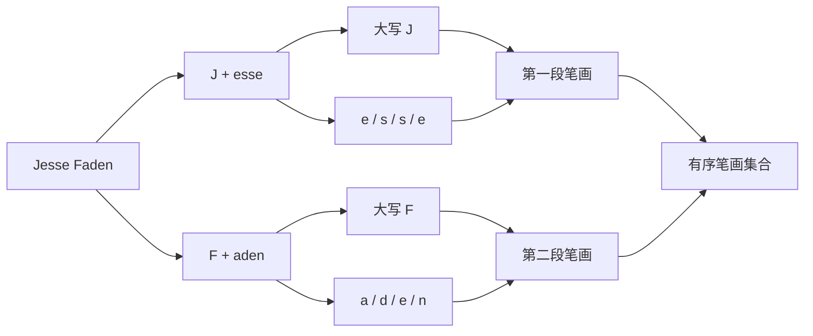

*图 3. 以 Jesse Faden 为例，解析后形成两个局部动作域。*

| 姓名 | 解析结果 |
| --- | --- |
| Jesse Faden | `J + esse`，`F + aden` |
| McDonald | `M + c`，`D + onald` |
| Jodie d'Angelo | `J + odie`，`D`，`A + ngelo` |

分段器对空格、标点和邻接大写分别设置 12、8、4 个内部坐标单位的名义间距，再乘以 $0.7+0.3s$，其中 $s$ 是归一化的结构保留度。姓名中的非首字母大写因此可以获得第二个视觉重心，而不强制换行或展开完整词形。

### 3.2 段落坐标系与基线

每个签名段建立独立的局部坐标系。大写模板高度约 30 个单位，首段缩放系数为 1，后续段使用固定书写者随机流采样 $k\sim U(0.80,0.93)$。大写模板的每个点 $(u,v)$ 通过下式映射至全局坐标：

$$
 x=x_0+k(u-\lambda v),\qquad y=y_0+kv,
$$

其中 $\lambda\sim U(0.09,0.18)$ 为斜切系数。在纵轴向下的屏幕坐标中，这种变换形成从左下至右上的笔势倾角。段首基线为 $y_0=0.18y_{\rm prev}+0.28z$，$z$ 来自本次签署的有界正态采样。

段内维护两个状态：`curx` 表示下一个小写的名义水平位置，`base` 表示局部基线。字母原语生成后推进 `curx`，并用下式使基线缓慢趋向段首位置：

$$
 b_{i+1}=(0.78+0.16f)b_i+(0.22-0.16f)y_0+0.10(1-f)z_i.
$$

$f$ 为整体流畅度；当前界面固定 $f=1$，因此基线更新主要是缓慢回归。`curx` 与实际笔尖位置分别维护，允许圈体回折、跨越基线及局部高位出笔。

## 4. 运动原语库

运动原语是生成器的最小可编辑动作单元。它描述笔尖途经的控制点，而非闭合的字形轮廓。一个原语可以包含上行、下探、绕圈、肩部或反向横扫等局部结构，最终通过统一的曲线处理生成连续墨迹。

### 4.1 大写笔画拓扑

大写字母的笔画计划（Capital Stroke Plan）描述自身的有序书写路径，以及与其后小写之间的过渡关系。

```typescript
type CapitalStrokePlan = {
  main: Point[];
  aux: Point[][];
  join: 'direct' | 'lift' | 'legacy';
  reentry?: Point | null;
};
```

`aux` 中的路径先输出；`main` 为最后一条大写主笔画。`join` 决定该主笔画是否直接进入小写：

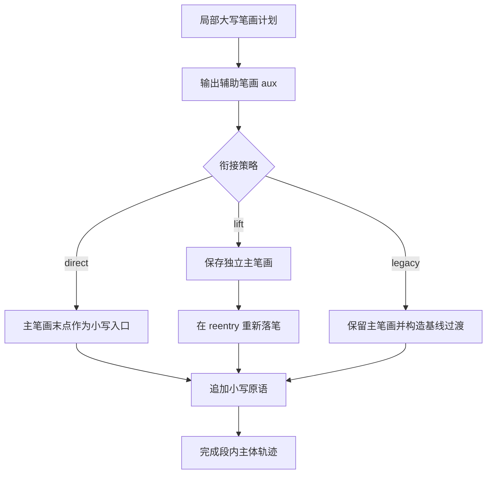

*图 4. 大写笔画拓扑与衔接策略。图中小写分支对应存在小写后缀的情况；无后缀时直接保存大写路径。*

| 大写类别 | 典型笔顺 | 衔接策略 |
| --- | --- | --- |
| H | 左竖、中横、右竖 | 右竖末点直接进入小写 |
| K | 独立竖干、斜臂经过中腰折返 | 下臂直接进入小写 |
| P | 顶部横扫、主体圈、折返竖干 | 一笔完成大写后提笔重入 |
| N | 上挑、回落、向右上方收笔 | 在高位终点下方重入 |
| X | 上行斜划、交叉下行曲线 | 第二笔直接进入小写 |
| Q | 主体椭圆及右下方收笔 | 末笔直接进入小写 |
| F / T | 独立横画与下行主干 | F 提笔重入，T 连续出笔 |
| O / U / V / W | 保留高位收笔的主体 | 提笔重入 |
| 其余大写 | 单条模板路径 | 基线过渡 |

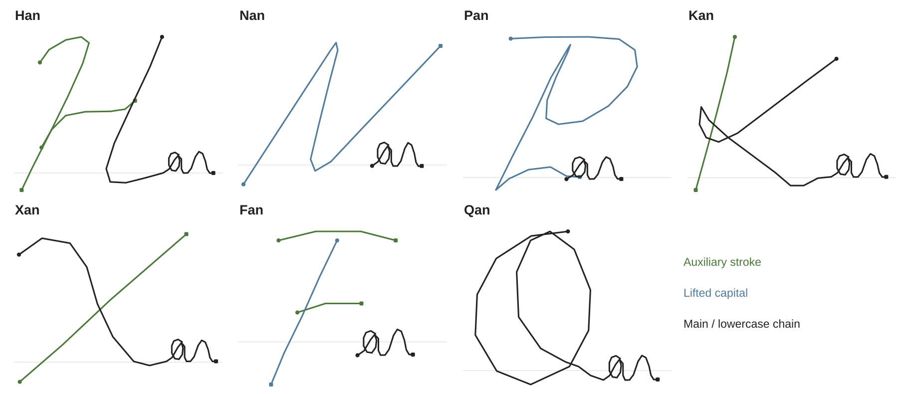

*图 5. 从 `generate()` 读取的真实中心线。绿色为辅助笔画，蓝色为提笔前独立大写，黑色为主体或小写链；圆点标记起点，方点标记终点。每种笔画拥有独立的坐标序列。*

提笔策略还允许设置特定字母的重入留白。例如 F 的首个小写需要越过横画覆盖的区域，其重入坐标额外增加 2.2 个普通小写的名义步进宽度。该补偿与横向尺度、缩写程度和速度代理联动，且不受大写自身的缩放系数影响。

### 4.2 小写字母的运动文法

小写原语在归一化局部坐标中定义。大部分字母的主体仅占约一个基线高度，上行和下探结构延伸至其上下。与大写相比，小写的变化更多依赖主体类型，而非完整字符外轮廓。

| 原语类别 | 字母示例 | 主要几何信息 |
| --- | --- | --- |
| 圈形主体 | a、o、d、g、q | 颈部入笔、主体绕圈、收笔分支 |
| 独立圈形 | e、p、b | 特定入笔顺序和主体方向 |
| 上行折返 | h、l、d、b | 上探、窄折返、回落至基线 |
| 下探回卷 | g、y、j、p、q | 下探杆、底部回钩、返回 |
| 开放主体 | u、v、w | 槽形和拱形的局部尺度 |
| 肩部与短划 | m、n、r、c、s 等 | 压缩的弧线起伏和折返点 |
| 外置标记 | i、j | 独立点或短斜划 |

这些类别可以重叠。d 同时包含主体圈和上行折返，p 包含主体圈和下探回卷。通过组合这些局部结构，可以调整签名复杂度，同时保持字母之间的区别。

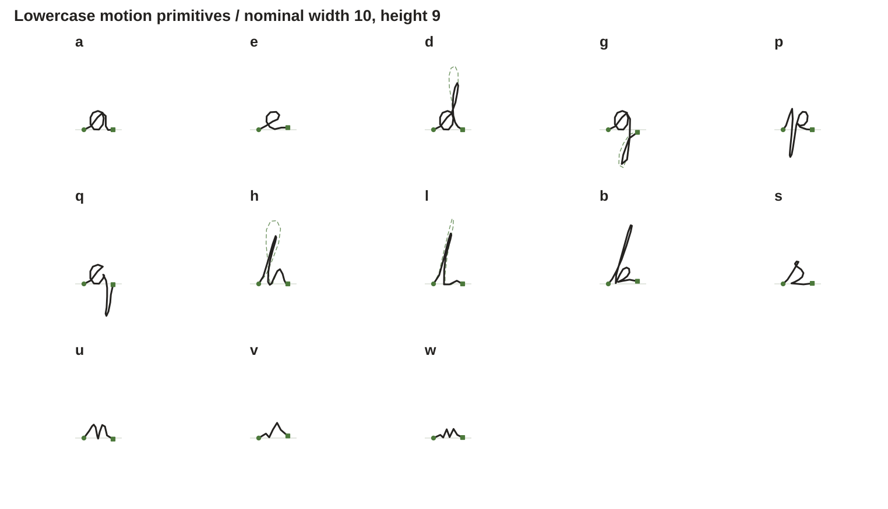

*图 6. 从 `motif()` 直接读取的原始控制点连线，统一宽度 10、高度 9、圈体倍率 0.72。绿色虚线为可选大回环；圆点为入笔，方点为出笔。图中尚未执行结构混合和曲线拟合。*

### 4.3 从颈部进入主体圈

为了让 a、d、g、o、q 的圈体具有相近视觉尺度，生成器采用共享主体模板 `BODY_BOWL`：

```javascript
const BODY_BOWL = [
  [0,0], [.20,-.15], [.47,-.60], [.72,-.91],
  [.49,-1.01], [.25,-.91], [.13,-.66], [.13,-.29],
  [.30,-.02], [.54,-.01], [.73,-.28], [.77,-.63],
  [.69,-.91]
];
```

这个点列从基线向右上方进入圈体颈部，再沿主体左侧、底部和右侧形成回绕。到达颈部后，按具体字母追加不同的动作。a 接短竖并出笔；o 保持较高的出笔位置；d 向上探再返回；g 与 q 则下探后回卷。

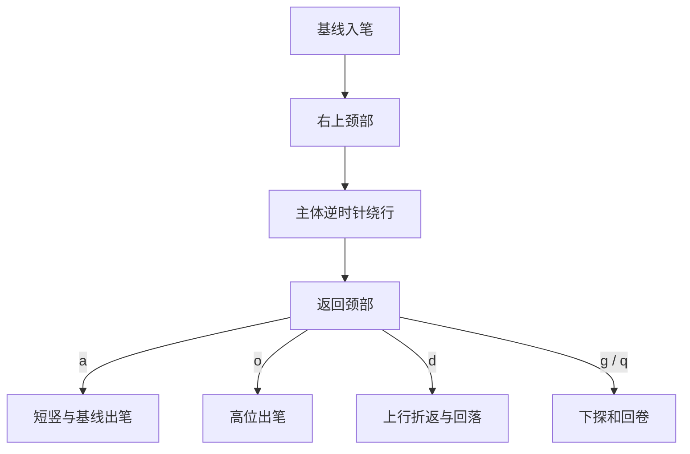

*图 7. 共享主体圈的运动结构。分支决定圈体之后的杆部动作。*

p 采用独立的左侧下探杆和右侧圈体，q 则从左侧主体进入右侧下探杆。b 的上行笔势为窄回折，返回基线后写右侧低圈。s 的主体通过顶部短钩、弓形下扫和基线处反向横扫描述。它们在压缩状态下仍保持不同的笔顺拓扑。

### 4.4 局部尺度变换

圈体调节针对一个原语的局部节点区间，而不是整个字符。设作用区间为 $[a,b]$，缩放中心为 $C$，边缘过渡节点数为 $m$。对第 $i$ 个节点定义权重：

$$
 g_i=\max\left(0,1-\frac{\operatorname{dist}(i,[a,b])}{m+1}\right).
$$

首尾控制点强制保持原位。设圈体控制倍率为 $\sigma$、字母特定校准倍率为 $\mu$、尺度扰动为 $\eta\sim U(0.94,1.06)$，则局部变换为：

$$
 P_i'=C+\left[1+(\sigma\eta\mu-1)g_i\right](P_i-C).
$$

例如 q 的主体圈校准倍率为 1.02，下探段为 0.98；p 的两部分分别采用 0.98 和 0.94。u、v、w 虽然不包含闭合圈形，也采用局部尺度函数控制开放主体的几何大小。

变换在归一化坐标系内完成，随后再施加独立的横、纵尺度。由此可改变圈体大小而保持名义字母步进，也可以将圈体压成扁平或细长的形态。`scaleCircle()` 将变形渐变分布到作用区间边缘，保留原语入口和出口的连接角色。

### 4.5 大回环、微回环与点划

回环按运动语义分层控制。g、y、j 的大回环位于基线下方，d、l、h 的大回环位于基线上方；关闭这些开关后，原语中的紧凑折返仍然存在。h 的大回环沿右侧上行，在顶部逆时针转向，向下返回后进入肩部。b 使用固定的窄上行结构。

额外微卷用于增加短划中段的形态变化。其采样概率为 $0.11+0.21m_c$，$m_c$ 为小回环强度。只有位于段中且属于允许集合的字符才可能获得插入的四个卷曲控制点；已有主体圈的字母、开放主体以及 n、s 不执行这项插入。卷曲横纵半径分别采用 $(1.05+1.3m_c)\sigma X$ 和 $(1.05+1.3m_c)\sigma Y$。

i、j 的头部标记单独生成。点半径在 0.86–1.02 单位间采样，短划长度为 2.3–4.0 单位，方向在约 −0.48 弧度附近带轻微扰动。标记的横坐标随字母推进位置移动，纵坐标随纵向尺度变化。它们最后作为独立 SVG 图元绘制，不参与小写主体的连笔中心线。

## 5. 从原语到整段连续笔势

### 5.1 横向步进与纵向结构

小写字母的局部形状通过横向步进 $w$ 与纵向高度 $h$ 映射到当前段坐标。设 $a$ 为缩写程度、$v$ 为速度代理、$X$ 和 $Y$ 为横纵尺度：

$$
 w=w_0(1.12-0.45a)(1-0.11v)\,U_w\,X\,\ell,
$$

$$
 h=h_0\,U_h\,Y.
$$

$U_w\sim U(0.94,1.06)$，$U_h\sim U(0.92,1.08)$；开启大回环时 $\ell=1.12$，否则为 1。

| 字母 | 名义步进 $w_0$ | 主体高度 $h_0$ |
| --- | ---: | ---: |
| g、y、j | 14.6 | 9.3 |
| p | 14.6 | 9.0 |
| d、l、h、b | 13.1 | 9.0 |
| i | 7.2 | 9.0 |
| 其余 | 9.6 | 9.0 |

归一化的原语点 $(u_i,v_i)$ 首先得到原始局部坐标 $(wu_i,hv_i)$。随后按结构保留度 $s$ 与流畅度 $f$ 计算纵向保留系数 $r$：

$$
 r=\begin{cases}
 1, & \text{g、d、l、y、j、h、p、b、s},\\
 (0.80+0.20s)(1-0.10f), & \text{其余受保护主体},\\
 (0.28+0.72s)(1-0.56f), & \text{其他小写}.
 \end{cases}
$$

令 $t$ 为归一化节点索引，快速笔势的纵向基形为：

$$
 Q(t)=-h[0.23+0.14\sin(1.8\pi t)].
$$

结构混合的结果为：

$$
 y(t)=[rhv_i+(1-r)Q(t)\sin(\pi t)](0.90+0.10s).
$$

高位及下探字母保留完整的运动骨架，普通小写则可以更接近低幅度的短划。最终将节点平移至 $(\mathrm{curx},\mathrm{base})$。这个机制让姓名辨识信息集中在关键笔势，而非平均分布到每个字母。

### 5.2 连续路径拼接

每个字母原语的第一点与主体上一个终点对齐。对于 n、b 和紧凑模式下的 h，生成器还对原语前半段进行偏移补偿：设原入口与实际笔尖之间的差值为 $\Delta$，使用平滑阶跃函数（Smoothstep）将该差值逐渐衰减。

$$
 u=\max(0,1-2t),\qquad P_i'=P_i+\Delta u^2(3-2u).
$$

随后统一进行位置对齐与追加：

```javascript
if (points.length) pts[0] = points[points.length - 1];
if (points.length) points.push(...pts.slice(1));
else points = pts.slice();
curx += letterWidth;
```

同一小写链因此只需要保存一组中心线。连接处的曲率由后续的样条拟合统一处理。对高于局部基线的出笔，代码还能追加短距离的回归基线节点，使后续字母沿合理的高度进入。

## 6. 风格控制与确定性随机流

### 6.1 参数空间

生成器将可见参数分为四组：字母结构、连笔尺度、尾笔动作和墨迹属性。结构保留与圈体大小作用于局部原语；快写程度、纵向拉伸作用于整段小写几何；尾笔参数独立控制末端动作；线宽与笔压微差留在渲染层。

| 控制项 | 默认值 | 范围 | 作用域 |
| --- | ---: | ---: | --- |
| 快写程度 | 50% | 0–100% | 小写横向几何与缩写代理 |
| 结构保留 | 22% | 0–100% | 原语纵向特征、段间距 |
| 圈体大小 | 72% | 45–140% | 局部主体与回环 |
| 纵向拉伸 | 100% | 55–160% | 全部小写高度 |
| 尾笔规模 | 35% | 0–100% | 右扫长度、盘绕尺寸及预算 |
| 盘绕长度倍率 | 18× | 1–60× | 非周期盘绕的长度预算 |
| 盘绕噪声 | 85% | 0–100% | 叶瓣形态及长度扰动 |
| 线宽 | 1.15 | 0.70–2.00 | 主体轮廓、短划宽度 |
| 笔压微差 | 4% | 0–8% | 主体轮廓的低频宽度变化 |
| i/j 短划概率 | 42% | 0–100% | 点与短划的选择 |

大回环按字母独立开关，默认开启 h，其余关闭。盘绕尾笔默认关闭。整体流畅度、圆滑度和小回环强度在 `getOptions()` 中固定为 100%。

### 6.2 快写程度的联合映射

速度、缩写和横向拉伸同时决定名义字符宽度。将它们合并为一维控制量，可减少用户在相近视觉效果之间反复调整的成本。

设快写程度为 $D\in[0,100]$，$t=(D-50)/50$，内部参数以旧版默认值为锚点线性变化，并进行整数化：

$$
\begin{aligned}
 \mathrm{sp}&=\operatorname{round}(79+21t),\\
 \mathrm{ab}&=\operatorname{round}(94+6t),\\
 \mathrm{xstretch}&=\operatorname{round}(100+45t).
\end{aligned}
$$

| 快写程度 | 速度代理 | 缩写程度 | 横向拉伸 | 普通小写名义宽度（未计噪声） |
| ---: | ---: | ---: | ---: | ---: |
| 0% | 58% | 88% | 55% | 3.58 |
| 50% | 79% | 94% | 100% | 6.11 |
| 100% | 100% | 100% | 145% | 8.30 |

在当前映射下，横向拉伸的影响占主导，控制量增大时小写链趋向横向舒展。将快写设为 0%、纵向拉伸设为 160%、圈体设为 140%，就能得到图 1 中 Jesse Faden 的细长型签名结构。改变这些参数只会直接改变局部中心线几何，最终画布比例仍由整体包围盒确定。

### 6.3 书写者与单次签署

为使同一姓名的不同签署具有稳定的结构特征，代码使用三条确定性的伪随机数流：

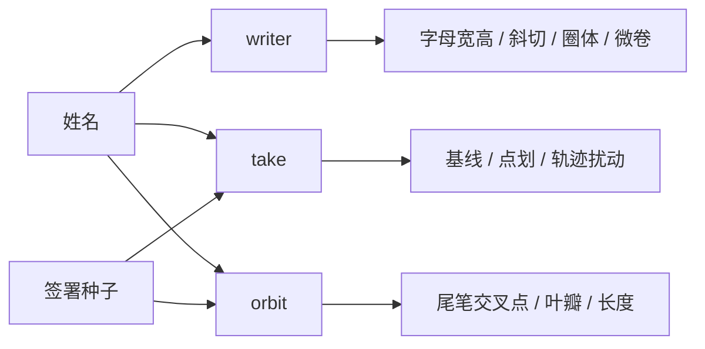

*图 8. 随机流的输入和主要消费位置。*

```javascript
const writer = random(hash(name + '|signature-writer-v06'));
const take = random(hash(name + '|' + opt.seed + '|subtle-take-v06'));
// 盘绕尾笔的独立随机流
const R = random(hash(name + '|' + opt.seed + '|free-orbit-v076'));
```

姓名固定的 `writer` 决定比例和笔势选择，`take` 随签署种子变化，`R` 专门负责非周期尾笔。随机流使用 FNV-1a（Fowler–Noll–Vo）风格的 32 位哈希及轻量级伪随机状态变换；在姓名、完整参数与实现版本一致时，可重现同一组完整路径。

比例参数采用均匀分布。轨迹偏移等需要集中于零附近的变量采用 Box–Muller 变换（Box–Muller Transform），并对输出限幅：

$$
 z=\operatorname{clamp}\left(\sqrt{-2\ln u_1}\cos(2\pi u_2),-2.15,2.15\right).
$$

这种分布把大部分变化限制在较小的空间范围内，同时保留少数更明显的变体。

### 6.4 转角感知的空间相关扰动

主体笔画完成后，生成器沿累计折线距离 $d$ 施加低频漂移。对每个内部节点，根据前后线段计算归一化转角 $\theta=\arccos(\hat a\cdot\hat b)/\pi$。转角较大时降低扰动强度，以保护微小回环。

$$
 A=(0.28(1-f)+0.10)e[1-\operatorname{clamp}(1.6\theta,0,0.8)].
$$

其中内部节点的 $e=0.82$，首尾端点的 $e=0$。每条主体笔画采样四个固定随机系数 $k_0,\dots,k_3$，偏移为：

$$
\begin{aligned}
 \delta_x(d)&=A[k_0\sin(d/27+0.35)+0.18k_2\sin(d/12.5)],\\
 \delta_y(d)&=A[k_1\sin(d/30+0.18)+0.16k_3\sin(d/15)].
\end{aligned}
$$

由于扰动随几何距离连续变化，相邻节点具有相关性。辅助大写笔画跳过这一步，使横画和主干等局部交叉关系保持相对稳定。尾笔在此步骤之后生成，从而继承已完成的主体末端。

## 7. 连续尾笔与非周期盘绕

尾笔为签名建立整体结束姿势。生成器提供普通右扫与不规则盘绕两种模式，都从最后一条主体笔画的真实终点延伸，并存放于同一笔画数组。

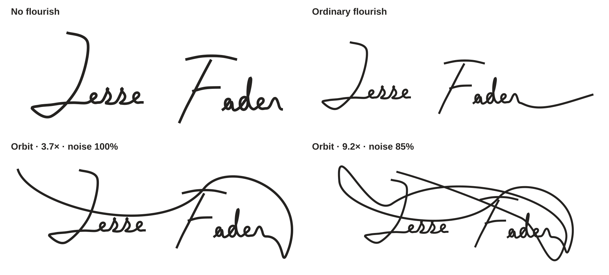

*图 9. 相同姓名、种子及主体形态参数下的实际 SVG 输出。从左上至右下为无尾笔、普通尾笔、3.7 倍盘绕及 9.2 倍盘绕。各图按自身边界展示。*

### 7.1 普通尾笔的三次贝塞尔模型

设主体终点为 $P_0$，末端估计单位切线为 $T$，尾笔强度为 $f_t$。普通模式采用三次贝塞尔曲线（Cubic Bézier Curve）：

$$
 B(t)=(1-t)^3P_0+3(1-t)^2tP_1+3(1-t)t^2P_2+t^3P_3.
$$

控制柄及名义水平延伸长度为：

$$
 L=15+71f_t,\qquad P_1=P_0+(7+13f_t)T.
$$

后两个控制点位于主体右侧，并带有轻微的纵向抬升或下落。$L$ 是名义水平延伸长度，并非普通尾笔的真实弧长。采样后将第一个重复的点排除，其余节点追加至当前笔画：

```javascript
const samples = sampleCubic(join, p1, p2, end, sampleCount);
s.points.push(...samples.slice(1));
```

主体与尾笔因而严格共享接点，满足位置连续（Positional Continuity，$C^0$）。起始控制柄继承估计的末端方向，后续统一拟合负责平顺接缝附近的离散节点。

### 7.2 非周期盘绕的轨迹拓扑

盘绕模式以交替折返的横八字走势组织运动。它在整份姓名的包围盒上定义外转点、内部交叉点和对应单位切线，再将这些点连接为连续曲线。每个叶瓣的纵向跨度、横向交叉区域及方向均由随机流单独采样。

令主体包围盒的宽高为 $W=\max(8,x_{\max}-x_{\min})$、$H=\max(10,y_{\max}-y_{\min})$。盘绕的纵向参考中心为 $c_y=y_{\min}+0.60H$，外部余量与振幅为：

$$
 p=3+7f_t,\qquad A=\max(6,H(0.30+0.30f_t),0.9\sqrt W).
$$

外转点位于姓名右边缘或左边缘之外，交叉点在主体宽度 13%–87% 的范围内切换，其偏好中心在 30% 和 70% 之间交替。噪声决定每次采样的分布跨度，并使叶瓣尺寸、倾角和交叉位置产生差异。即便噪声为零，算法仍保留部分基础随机采样，避免每圈重复同一轨迹。

相邻节点 $P_i,P_{i+1}$ 使用共享方向构造贝塞尔控制点：

$$
 C_1=P_i+h_1D_i,\qquad C_2=P_{i+1}-h_2D_{i+1}.
$$

上一段的终止方向 $D_{i+1}$ 同时作为下一段的起始方向。该构造满足节点处的几何一阶连续（Geometric Continuity，$G^1$），控制柄长度则可独立变化。随后统一进行样条与重采样处理。

### 7.3 基于长度预算的终止条件

盘绕轨迹的控制量为长度倍率 $M$，而非完整叶瓣数量。设盘绕噪声 $n$ 为归一化值，$z$ 为限幅正态样本，目标长度为：

$$
 L_{\rm orbit}=(15+71f_t)M\operatorname{clamp}(1+0.18nz,0.65,1.35).
$$

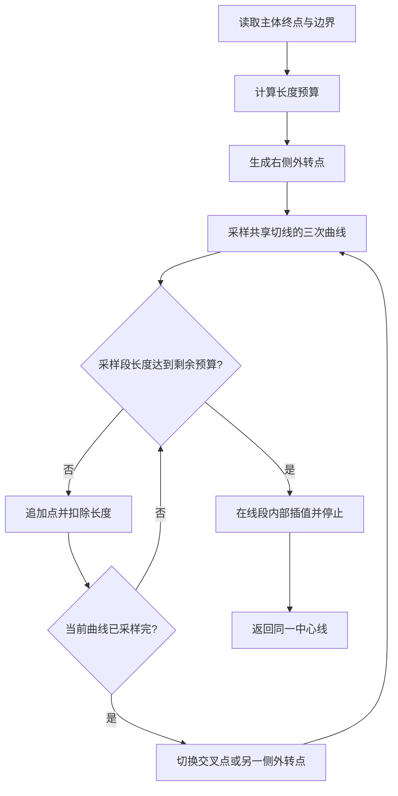

*图 10. 非周期盘绕的几何长度终止流程。实现另设最多 600 次交替循环的上限。*

对每个贝塞尔采样段计算与上一节点之间的距离。如果距离超过剩余预算 $r$，就在该线段内按 $r/d$ 进行线性插值，将插值点作为整个尾笔的终点：

```javascript
if (d >= remaining) {
  const k = remaining / d;
  s.points.push(v(
    last.x + (p.x - last.x) * k,
    last.y + (p.y - last.y) * k
  ));
  remaining = 0;
  return false;
}
```

预算按贝塞尔曲线的采样折线长度消耗，后续拟合得到的中心线弧长可能发生轻微变化。由于终止点可以落在任意采样区间，尾笔无需结束在完整横八字的端点。在较短预算下，它也可以只覆盖主体的一部分。

## 8. 曲线拟合与几何重采样

运动原语产生的是稀疏控制点。将这些节点转换为随几何距离均匀分布的连续曲线，需要先处理节点的转折，再插值拟合，最后重采样。

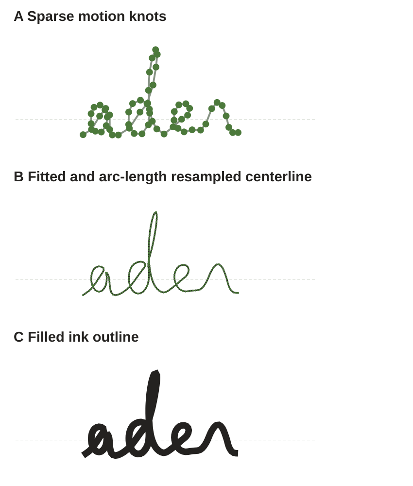

*图 11. Jesse Faden 的第二段小写主体。A 为 `generate()` 输出的实际控制点；B 为 `interpolate()` 输出的曲线采样点；C 为 `outline()` 生成的墨迹轮廓。三行使用同一坐标尺度。*

### 8.1 局部节点平顺

对于非端点节点 $P_i$，以邻居之和与当前点的差为平顺位移，按照局部转角减弱高曲率处的处理：

$$
 \beta_i=0.16s_m(1-0.12\theta_i),
$$

$$
 P_i'=P_i+\beta_i(P_{i-1}+P_{i+1}-2P_i).
$$

其中 $s_m$ 是圆滑度，当前界面固定为 1。首尾节点以及显式带 `keep` 标记的节点保持原位。此步骤在原始稀疏点列上执行，使平顺作用具有与笔势相适应的空间尺度。

### 8.2 Catmull–Rom 样条插值

Catmull–Rom 样条（Catmull–Rom Spline）使用四个相邻节点即可拟合经过中间两个节点的三次曲线。令 $P_0,P_1,P_2,P_3$ 为相邻节点，则 $P_1$ 至 $P_2$ 区间的表达式为：

$$
 C(t)=\frac12\left[2P_1+(-P_0+P_2)t+(2P_0-5P_1+4P_2-P_3)t^2+(-P_0+3P_1-3P_2+P_3)t^3\right].
$$

该插值在内部使用统一参数形式，端点外的虚拟邻居由最近端点补齐。每个区间使用 $\max(3,\lceil\|P_2-P_1\|/0.50\rceil)$ 个子区间采样。

实现保留了线性曲线 $L(t)$ 与样条之间的混合形式 $(1-s_m)L(t)+s_m C(t)$。在 v0.8.0 的默认面板中，$s_m=1$，因此直接取三次样条结果。

### 8.3 弧长重采样

样条采样点的几何距离受局部曲率影响。为了让轮廓展开时的切线估计和宽度调制更加均匀，`resample()` 先累计折线长度：

$$
 d_0=0,\qquad d_i=d_{i-1}+\|P_i-P_{i-1}\|.
$$

对目标距离 $s_j=j\Delta d$，寻找满足 $d_i\le s_j<d_{i+1}$ 的区间，通过线性插值求取新采样点：

$$
 Q_j=P_i+\frac{s_j-d_i}{d_{i+1}-d_i}(P_{i+1}-P_i).
$$

当前步长 $\Delta d=0.43$ 个内部坐标单位，首尾点单独保留。由于目标距离和区间索引都单调增加，可以顺序遍历点列，避免对每一个目标点重新搜索全部区间。

## 9. 墨迹轮廓与 SVG 输出

### 9.1 中心帧与法向展开

圆珠笔草签的笔宽在多数情况下保持相对稳定。生成器使用中心线两侧的法向偏移构建闭合多边形，便于将轻微笔宽变化直接编码至 SVG 轮廓中。

设重采样后的中心线为 $Q_i$，用相邻位置估计单位切线和法向：

$$
 T_i=\frac{Q_{i+1}-Q_{i-1}}{\|Q_{i+1}-Q_{i-1}\|},\qquad N_i=(-T_{iy},T_{ix}).
$$

两侧轮廓为：

$$
 L_i=Q_i+r_iN_i,\qquad R_i=Q_i-r_iN_i.
$$

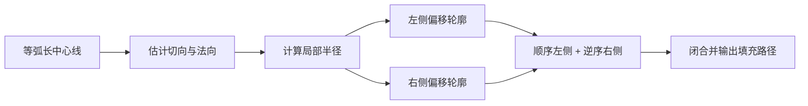

*图 12. 中心线到填充墨迹的转换。*

最终多边形按 $L_0,\ldots,L_m,R_m,\ldots,R_0$ 的顺序连接并闭合。所有坐标序列化为两位小数，墨迹使用 `#242220` 填充。i、j 的独立点使用圆形图元，短划使用带圆端的线段。

### 9.2 有界笔宽调制

笔宽变化使用一个低频三项函数。设 $u=i/(n-1)$ 为重采样节点归一化索引，$\phi$ 为笔画固定相位：

$$
 M(u)=0.68\sin(5u+\phi)+0.21\sin(12u+0.31\phi)+0.11\cos(18u+0.7\phi).
$$

$$
 r(u)=\frac{b_w}{2}\operatorname{clamp}(1+\alpha M(u),1-\alpha,1+\alpha).
$$

$b_w$ 是基准线宽，$\alpha$ 为笔压微差，范围 0–0.08。三项振幅的绝对值之和为 1，因此名义线宽变化被约束在 $b_w(1\pm\alpha)$ 内。默认线宽 1.15、笔压 4% 时，名义宽度位于 1.104–1.196 个内部坐标单位。通过弧长近似均匀的采样，宽度调制在空间上也具有较为均匀的变化速度。

### 9.3 画布变换

`render()` 根据所有主体笔画节点和标记锚点求取包围盒，在各边增加 3 个内部单位的余量。宽高记为 $W,H$，适配到固定画布 `viewBox="0 0 880 220"` 的缩放系数为：

$$
 k=\min(1.92,790/W,137/H).
$$

平移量设为 $o_x=39-kx_{\min}$、$o_y=112-k(y_{\min}+y_{\max})/2$。所有墨迹统一应用 `translate(ox oy) scale(k)`，在画布中靠左且垂直居中。独立的矢量坐标与显示比例使生成器可以服务网页预览、文稿叠层和高分辨率导出。

## 10. 参数覆盖与可复现验证

图 1 的十组样例采用不同姓名、随机种子及形态参数，展示整个模型的可调范围。样例设计特意包含横向极度压缩、宽高反向极值、无尾笔、密集盘绕和较大的笔宽差异。

| 姓名 | 种子 | 快写 | 圈体 | 纵向 | 尾笔 | 盘绕倍率 |
| --- | ---: | ---: | ---: | ---: | ---: | ---: | ---: |
| Jesse Faden | 137 | 0 | 140 | 160 | 25 | — |
| Alan Wake | 41 | 100 | 45 | 55 | 100 | — |
| Hayley Joy | 503 | 78 | 110 | 135 | 14 | — |
| Jodie d'Angelo | 211 | 54 | 95 | 90 | 45 | 3.7× |
| McDonald | 89 | 97 | 60 | 105 | 0 | — |
| Sanjay Hughes | 719 | 25 | 120 | 70 | 48 | 8.3× |
| Margie Golding | 327 | 35 | 45 | 125 | 33 | — |
| Kayley Brooks | 61 | 87 | 85 | 80 | 72 | 24.7× |
| Quinn Phelps | 983 | 15 | 125 | 145 | 20 | — |
| Xavier Fawcett | 19 | 65 | 75 | 100 | 50 | 1.4× |

十组样例覆盖快写和结构保留的 0–100%、圈体 45–140%、纵向 55–160%、尾笔规模 0–100%、线宽 0.70–2.00、笔压微差 0–8%，以及盘绕噪声和短划概率的 0–100%。盘绕长度倍率的展示范围为 1.4–24.7×，完整控制项支持 1–60×。

### 10.1 回归测试

使用 Playwright 在 Chromium 浏览器中运行仓库测试脚本：

```bash
python -m pip install playwright
python -m playwright install chromium
python tests/test_signature.py
```

本次针对 v0.8.0 实际源码的执行结果：

```text
PASS: 10 gallery presets, extreme geometry, UI controls, SVG export
```

| 检查项 | 结果 |
| --- | --- |
| 十组姓名与不同种子 | 通过 |
| 相同输入的 SVG 字符串一致性 | 通过 |
| 主体与独立标记坐标为有限数值 | 通过 |
| 主体末端与已生成尾笔起点的距离小于 $10^{-9}$ | 通过 |
| 快写 0、纵向 160、圈体 140 的参数映射 | 通过 |
| 姓名输入、种子递增、重置与盘绕控件联动 | 通过 |
| 浏览器 SVG 文件下载与脚本异常检查 | 通过 |

上述测试覆盖功能、可复现性和关键几何断言。图册提供视觉对照，后续可结合曲率分布、墨迹密度与最小回环半径建立自动质量指标。

## 11. 文稿系统接入与资产管理

### 11.1 直接调用生成接口

打开仓库的 `index.html` 后，可以通过公开的应用程序接口（Application Programming Interface，API）调用生成器。完整参数以图册配置文件为基础，可直接复现指定角色的签名。以下示例复现图 1 首组的几何设置：

```javascript
const lab = window.SignatureMotionLabV080;
const options = {
  ...lab.getOptions(),
  seed: 137,
  drive: 0, sp: 58, ab: 88, xstretch: 55,
  ystretch: 160, bowl: 140, struct: 30,
  flow: 100, sm: 100, micro: 100,
  fl: 25, bw: 1.10, pr: 3, dash: 0,
  tailorbit: false, orbitcount: 18, orbitnoise: 85,
  loops: { g: false, d: true, l: false, y: false, j: false, h: false }
};
const result = lab.render('Jesse Faden', options);
const svg = result.svg;
```

`getOptions()` 完成界面参数到内部尺度的映射；直接调用 `generate()` 或 `render()` 时应传入已经展开的 `sp`、`ab`、`xstretch`。`generate()` 可用于单独提取原始几何与事件数据。

### 11.2 独立签名叠层

在文稿系统中，签名图层适合与正文、签字信息层解耦。排版系统继续管理印刷姓名、岗位和签字线的位置；签名生成器仅提供独立视觉资产。叠层可以施加轻微旋转和位置偏移，并允许笔迹自然越过签字区域附近的文字。

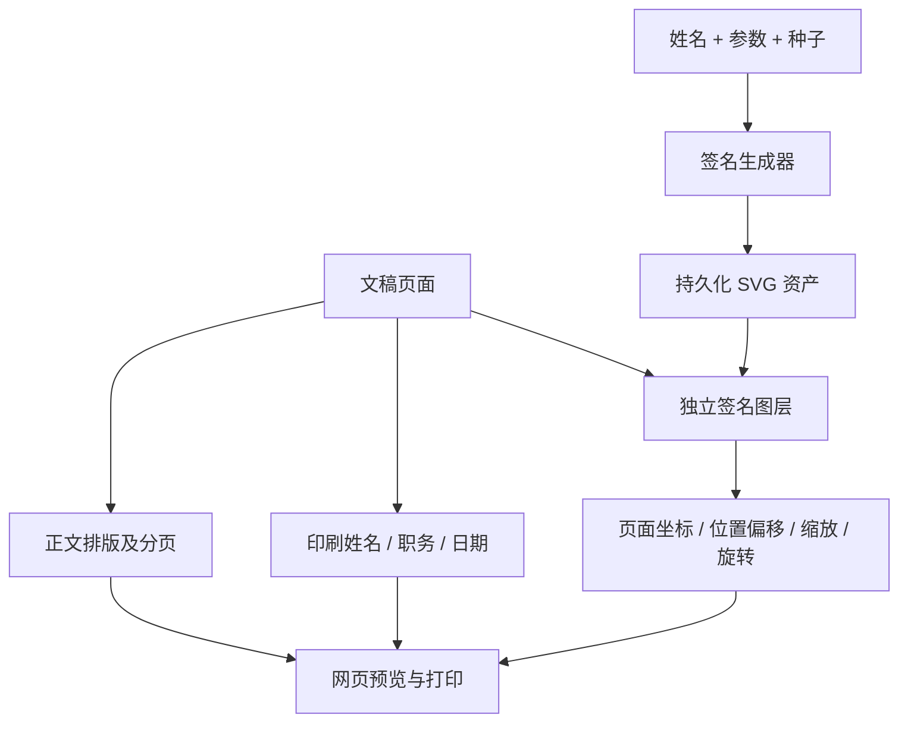

*图 13. 推荐的文稿接入架构。当前独立实验台已提供生成与 SVG 导出；页面叠层由宿主文稿系统实现。*

导出的独立 SVG 含白色画布矩形。作为叠层使用时可去除该矩形，仅保留墨迹图元，并按照实际签字区域确定裁切及显示比例。文稿中建议同时记录算法版本、姓名、种子、完整参数和最终 SVG：

```json
{
  "signatoryName": "Jesse Faden",
  "algorithmVersion": "0.8.0",
  "seed": 137,
  "presetId": "gallery-01",
  "signatureAsset": "signatures/jesse-faden.svg"
}
```

该结构为接入建议。已生成的文稿应保留最终矢量文件，参数用于复现和重新编辑。这样即使生成器后续更换运动原语或调整随机调用顺序，历史文稿的墨迹也能保持不变。

## 12. 技术边界与进一步研究

当前系统的轨迹来源是显式编写的几何运动文法，适用于拉丁姓名的装饰性草签渲染。生成过程完全在浏览器内完成，未使用真人签名训练数据。对于更大规模的笔迹生成，主要可沿三个技术方向扩展。

第一，建立几何质量度量，将曲率峰值、相邻笔势转向角、最小回环半径、局部墨迹覆盖及盘绕长度占比纳入自动化回归。第二，进一步拆分随机流，在段、字母和笔划层建立可派生的独立种子，提高局部原语迭代后的输出稳定性。第三，引入在线手写数据中的速度、压力和提笔状态，使用具有时间参数的轨迹模型学习角色级风格分布，并保留本文的矢量输出管线作为渲染后端。

这些研究方向与在线签名合成、运动学手写模型和文本条件序列生成相关：

- Galbally 等，*Synthetic on-line signature generation. Part I: Methodology and algorithms*，Pattern Recognition，2012。[DOI](https://doi.org/10.1016/j.patcog.2011.12.011)。面向签名运动学和频谱特性的合成方法。
- Galbally 等，*Synthetic on-line signature generation. Part II: Experimental validation*，Pattern Recognition，2012。[DOI](https://doi.org/10.1016/j.patcog.2011.12.007)。合成签名的实验评估。
- Plamondon，*Looking at handwriting generation from a velocity control perspective*，Acta Psychologica，1993。[DOI](https://doi.org/10.1016/0001-6918(93)90006-D)。从速度控制角度研究手写运动。
- Graves，*Generating Sequences With Recurrent Neural Networks*，2013。[arXiv:1308.0850](https://arxiv.org/abs/1308.0850)。包含文本条件手写序列生成的神经网络方法。

## 附录 A：工程调试与视觉回归经验

以下内容记录开发过程中具有复用价值的几何问题及处理方法，供修改原语和维护渲染器时参考。

| 现象 | 定位 | 处理方式 |
| --- | --- | --- |
| 字体式签名存在规律字距、局部重影 | 字体轮廓与程序笔势叠加，且字符仍按排版间距排列 | 统一使用有序中心线，独立于正文排版 |
| 每个字母过于清楚，整段缺乏快速书写感 | 辨识信息平均分配给逐字母骨架 | 大写承担锚点，小写采用分级结构保留 |
| H 类似 M、P 类似 R、N 末端出现冗余下行 | 大写模板被统一强制接到基线 | 将字母内部笔画计划与小写衔接策略分开 |
| F 与后续小写粘连 | 笔画几何和重入位置的控制混在一起 | 在提笔后直接增加 2.2 个名义步进的留白 |
| K 后的小写整体下沉 | 下臂终点偏离合理基线 | 独立定义主干和中腰斜臂，使连续出笔回到基线 |
| a、d、q 的圈体尺度不一致 | 各原语独立设定主体圈尺寸 | 共用颈部优先的主体模板，并进行局部尺度校准 |
| p 与 q 同形、b 上部出现不自然的大圈 | 主体与杆部的笔顺约束不足 | 独立左右下探拓扑；b 使用固定窄折返 |
| n 的随机小卷破坏肩部、s 接近 e | 附加装饰改变了核心笔势拓扑 | 保留专用原语并限制额外小卷的作用集合 |
| 所有大写突然变硬 | 对折线先做密集重采样，再使用局部样条 | 保留稀疏节点邻接关系，先拟合再按弧长重采样 |
| 尾笔折返过于规律 | 固定频率、幅度、周期的横八字轨迹 | 使用交替随机节点、共享切线及连续长度预算 |

回归测试应同时检查拓扑、几何和随机序列。尤其是原语局部调整，建议使用相同参数与种子保存修改前后的 SVG，再比较非目标字母样本是否保持一致。随机调用次数变化可能使之后生成的尺度和点划一同变化，应根据实际影响范围调整回归基线。

## 附录 B：快速使用与源码索引

无需安装运行时依赖，克隆仓库后打开 `index.html` 即可试用。调整形态及尾笔参数后，通过重新签署改变种子，通过导出 SVG 保存当前笔迹。

| 函数或数据 | 源码职责 |
| --- | --- |
| `parseSegments`、`CAP` | 姓名分段及基础大写模板 |
| `BODY_BOWL`、`motif`、`scaleCircle` | 小写原语与局部圈体几何 |
| `hash`、`random`、`normal` | 确定性随机数流与限幅分布 |
| `generate` | 段落布局、笔画计划、点划、轨迹扰动及尾笔 |
| `turning`、`interpolate`、`resample` | 转角估计、节点平顺、插值及均匀化 |
| `outline`、`render` | 墨迹轮廓与 SVG 输出 |
| `getOptions`、`update` | 界面参数映射与实时预览 |

原型的历史版本、当前源码和测试脚本均通过 [Signature Motion Lab GitHub 仓库](https://github.com/HSqure/signature-motion-lab) 管理，采用 MIT License。
